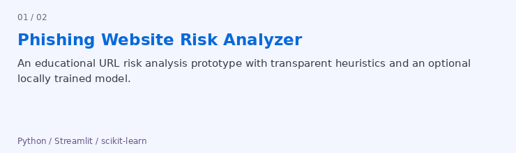

## Hi, I’m Yaser 👋

I’m a computer engineering student interested in artificial intelligence, computer vision, and software development. I enjoy connecting what I learn in the classroom with practical projects and exploring how technology can solve everyday problems.

Currently, I’m developing my skills in Python, machine learning, and image processing. This profile is a collection of my projects, experiments, and progress along the way. I’m open to exchanging ideas, learning from others, and collaborating on interesting projects.

---

### 🛠️ Tech Stack & Tools

 &nbsp;
 &nbsp;
 &nbsp;
 &nbsp;
 &nbsp;
 &nbsp;
 &nbsp;
 &nbsp;
 &nbsp;

---

### 🚀 Latest Projects

---

### 📫 Contact Me

Feel free to connect on LinkedIn to discuss projects, exchange ideas, or collaborate.

 &nbsp; 

